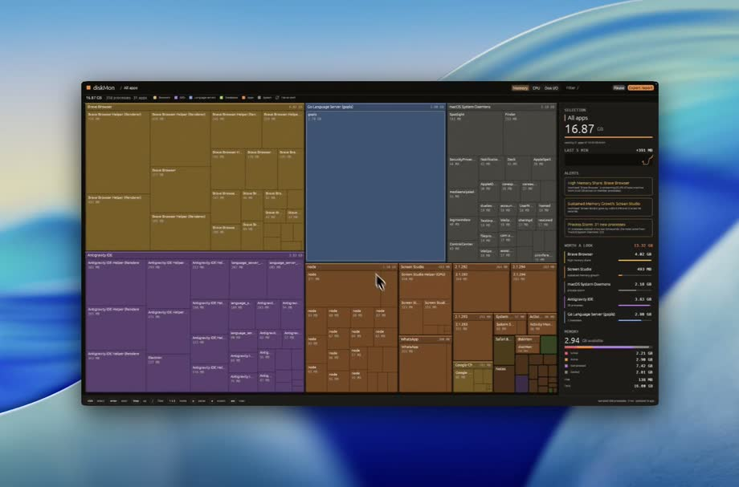

<p align="center">
  
</p>

<h1 align="center">diskMon</h1>

<p align="center">
  <strong>See where your computer's memory goes.</strong><br>
  Every process grouped into workloads, mapped in a live treemap, with rule-based diagnostic alerts.
</p>

<p align="center">
  <a href="https://github.com/antcybersec/diskMon/releases/latest"></a>
  <a href="https://diskmon.vercel.app"></a>
  <a href="#license"></a>
  
  
</p>

<p align="center">
  <a href="#download">Downloads</a> •
  <a href="#walkthrough">Walkthrough</a> •
  <a href="https://diskmon.vercel.app">Interactive Simulator</a> •
  <a href="#what-it-does">Features</a> •
  <a href="#keyboard-shortcuts">Shortcuts</a> •
  <a href="#build-from-source">Build</a>
</p>

---

## Walkthrough

<p align="center">
  <a href="https://diskmon.vercel.app">
    
  </a>
</p>

<p align="center">
  <em>Live process tree drill-down, memory treemap navigation, and memory leak diagnostics.</em><br>
  <strong><a href="diskkmon.mp4">▶ Watch Full 4K Video (60 fps)</a></strong> &nbsp;•&nbsp; 
  <strong><a href="https://diskmon.vercel.app">🌐 Try the Live Interactive Simulator</a></strong>
</p>

---

## Download

| Platform | Download |
| --- | --- |
| macOS 11+ (Apple Silicon and Intel) | [diskMon-macos-universal.dmg](https://github.com/antcybersec/diskMon/releases/latest/download/diskMon-macos-universal.dmg) |
| Windows 10 and 11 (64-bit) | [diskMon-windows-x64.exe](https://github.com/antcybersec/diskMon/releases/latest/download/diskMon-windows-x64.exe) |
| Linux x86_64, any distro | [diskMon-linux-x86_64.AppImage](https://github.com/antcybersec/diskMon/releases/latest/download/diskMon-linux-x86_64.AppImage) |
| Ubuntu 22.04+ / Debian 12+ | [diskMon-linux-amd64.deb](https://github.com/antcybersec/diskMon/releases/latest/download/diskMon-linux-amd64.deb) |

The apps are not code-signed yet, so your system asks you to confirm the first launch:

- **macOS:** open the `.dmg`, drag diskMon to Applications and open it. When macOS blocks it, go to **System Settings → Privacy & Security** and click **Open Anyway**.
- **Windows:** if SmartScreen warns you, click **More info → Run anyway**. It is a single `.exe` with nothing to install.
- **Linux (AppImage):** `chmod +x diskMon-linux-x86_64.AppImage` and run it. If it doesn't start, run it with `--appimage-extract-and-run`.
- **Linux (.deb):** `sudo apt install ./diskMon-linux-amd64.deb`, then open diskMon from your app menu or run `diskmon`.

## What it does

- **Groups processes into apps.** Helpers are folded into the app bundle they belong to, and about 30 well-known workloads are recognised: browsers, IDEs, language servers, Docker, Ollama, databases, build tools and system processes.
- **Nested treemap.** Each app is a tile with its processes inside. Size it by memory, CPU or disk I/O, zoom into any app, and filter by name.
- **Alerts.** An app using 25% or more of your RAM (critical at 40%), memory growth of more than 100 MB, sustained CPU at a full core or more for about 30 seconds, 30 or more new processes in about 20 seconds, and memory pressure of 75% or more.
- **Worth a look.** A short list of the apps most worth checking right now, with the reason.
- **Memory meter.** Used, cached and free memory, swap and memory pressure; on macOS also wired and compressed memory.
- **Reports.** Export a Markdown incident report to your Downloads folder, with your home folder path redacted.

Everything is collected and analysed on your computer. diskMon makes no network connections.

### Keyboard shortcuts

| Key | Action |
| --- | --- |
| click / Enter | Select / zoom into the selected app |
| Backspace | Back to all apps |
| `/` | Filter by name |
| `1` `2` `3` | Size by memory, CPU, disk I/O |
| `p` | Pause live updates |
| `e` | Export report |
| Esc | Clear filter, then selection, then zoom |

## Build from source

Requires a stable Rust toolchain. On Linux, also install the X11/Wayland headers:

```sh
sudo apt install libxkbcommon-dev libwayland-dev libx11-dev libxcursor-dev libxrandr-dev libxi-dev libgl1-mesa-dev
```

```sh
cargo run --release -p resource-ui    # desktop app
cargo run --release -p resource-cli   # one-shot report in the terminal
cargo test --workspace
```

`scripts/package-macos.sh` builds the universal `.dmg`; `scripts/package-linux.sh` builds the AppImage and `.deb` (needs `cargo-deb`). Releases are built by `.github/workflows/release.yml` when a `v*` tag is pushed.

### Workspace

| Crate | Purpose |
| --- | --- |
| `resource-core` | Data model, app grouping, treemap layout, history, alert rules, report export |
| `resource-platform` | Process and memory collection: libproc and Mach on macOS, `sysinfo` on Windows and Linux |
| `resource-ui` | The desktop app (egui) |
| `resource-cli` | Terminal report |

## License

MIT
